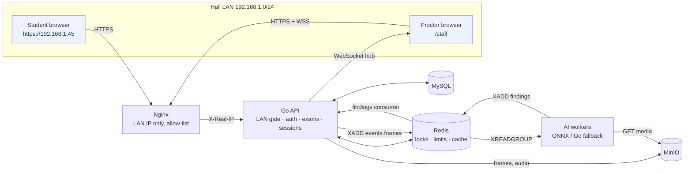

# Exam Shield — Documentation

Exam Shield is a network-locked, AI-assisted exam proctoring platform. Students
reach an exam only by typing the address their invigilator shows, only from the
exam hall network, and they land straight in the exam: no student accounts, no
dashboard. Staff run everything from a proctor dashboard.

**Contents**
1. [Overview & architecture](#1-overview--architecture)
2. [Network-locked access model](#2-network-locked-access-model)
3. [Installation](#3-installation)
4. [Environment variables](#4-environment-variables)
5. [Staff authentication & RBAC](#5-staff-authentication--rbac)
6. [Student roster & face matching](#6-student-roster--face-matching)
7. [API reference](#7-api-reference)
8. [Database schema](#8-database-schema)
9. [AI pipeline](#9-ai-pipeline)
10. [Frontend](#10-frontend)
11. [Error audit summary](#11-error-audit-summary)
12. [Testing](#12-testing)
13. [Deployment](#13-deployment)
14. [Troubleshooting](#14-troubleshooting)
15. [Changelog](#15-changelog)

---

## 1. Overview & architecture

| Layer | Technology |
|---|---|
| Frontend | React 18, Vite, TypeScript, Tailwind CSS (served by the Go binary via `go:embed`) |
| API | Go 1.24, Gin, GORM, golang-jwt (HS256), bcrypt |
| Realtime | Native WebSocket hub (gorilla/websocket) |
| AI | Go workers: ONNX Runtime (`onnxruntime_go`, build tag `onnx`) with a pure-Go fallback (pigo + LBP + energy VAD) |
| Database | MySQL 8 (distributed) or SQLite (standalone) |
| Locks / limits / streams | Redis 7 (Streams for the frame and findings queues) |
| Media | MinIO (private bucket) or local disk |
| Edge | Nginx, bound to the LAN IP only |

There are two ways to run it:

- **Standalone:** one binary on the invigilator's laptop. It uses SQLite, an embedded in-process Redis, files on disk, and an in-process AI worker. No Docker is needed.
- **Distributed:** `docker compose` with MySQL, Redis, MinIO, the API, one or more AI workers, and Nginx.



Design rules:
- The **API is the only writer** to the database. Workers read media and publish results to a stream.
- **AI results are prompts for a human.** Every alert can be confirmed or dismissed, and dismissing restores the integrity score.
- **Fail closed** on network identity, login throttling and identity. **Fail open** only where locking students out mid-exam would be worse; for example, the general rate limiter tolerates a Redis outage.

---

## 2. Network-locked access model

### Flow

```
Student types 192.168.1.45
  → http :80  ──308──▶ https :443            (webcams need a secure context)
  → Nginx: allow LAN_CIDRS; deny all          (first wall)
  → API Network gate on every request:        (second wall)
       client IP = TCP peer, or X-Real-IP only if the peer ∈ TRUSTED_PROXIES
       IP ∈ LAN_CIDRS and ∉ LAN_DENY_CIDRS     else 403 LAN_REQUIRED
  → Exam gate on /api/student/gate|verify:
       ACTIVE exam with starts_at ≤ now < ends_at and lan_cidr ∋ IP   else 423 EXAM_NOT_OPEN
       PIN (X-Exam-PIN or ?pin=) when the exam has one                else 401 PIN_REQUIRED / PIN_INVALID
  → Verify: consent + matric number + selfie (+ ID photo) → face match
       Redis: session_lock:<device_fp> ⇄ student_lock:<exam>:<student>  else 409 DEVICE_IN_USE / …
  → Fullscreen exam (no nav, no links, no logout) → submit → "Exam submitted"
```

### Subnet rules
- `LAN_CIDRS` defines who may reach the server at all. If unset, it is auto-detected from private interfaces (RFC 1918 / IPv6 ULA). Set it explicitly in production.
- Each exam's `lan_cidr` must be a private range, no broader than /8 (IPv4) or /32 (IPv6), and must overlap the server LAN. It is re-checked on every in-exam request.
- `LAN_DENY_CIDRS` excludes ranges inside the LAN, such as VPN pools.
- IPv6: zone IDs are stripped, IPv4-mapped addresses are treated as IPv4, and IPv6 CIDRs work.
- Loopback: staff may use `https://localhost` on the server itself (`ALLOW_LOOPBACK_STAFF`). Students may never connect via loopback unless `ALLOW_LOOPBACK_EXAM`, which is for tests only.

### PIN and QR
- **Require a PIN** generates a random 4-digit PIN from `crypto/rand`. It is unique among live exams.
- The QR code encodes `https://<ip>/?pin=<PIN>`. The page moves the PIN to `sessionStorage` and removes it from the address bar.
- Ten wrong PINs per IP in 5 minutes returns `429`.
- Two exams may share a subnet only if **both** have PINs; the PIN tells the gate which exam the student is entering.

### Failure states (what students see)

| Code | HTTP | Screen |
|---|---|---|
| `LAN_REQUIRED` | 403 | "Exam hall network required" (HTML page for non-API paths) |
| `EXAM_NOT_OPEN` | 423 | "No exam is open right now" — rechecks every 15 s |
| `PIN_REQUIRED` / `PIN_INVALID` | 401 | PIN form |
| `CONFLICT` | 409 | Several PIN-less exams on one subnet |
| `INSECURE_CONTEXT` | — | Page opened over plain HTTP; camera unavailable |
| `DEVICE_IN_USE` / `STUDENT_ACTIVE_ELSEWHERE` / `DEVICE_MISMATCH` | 409 | Call an invigilator (Unlock) |
| `ALREADY_SUBMITTED` / `SESSION_ENDED` | 409 / 410 | Done |

### Nginx
`deploy/nginx/templates/default.conf.template` binds `${LAN_IP}:80` and `:443`
only, applies the allow-list, and **overwrites** `X-Forwarded-For` and
`X-Real-IP` with `$remote_addr`. It rate-limits verify and login, and upgrades
`/api/staff/ws`. In Compose, Nginx runs with `network_mode: host` so it sees
real student IPs. The API trusts only the Docker gateway `172.28.0.1`.

---

## 3. Installation

### Standalone (one machine, no Docker)

Requirements: Go 1.24+ and Node 20+.

```bash
cd web && npm ci && npm run build && cd ..     # builds web/dist, embedded at compile time
go build -o exam-shield ./cmd/api
./scripts/gen-lan-cert.sh 192.168.1.45          # needs openssl; install deploy/certs/ca.crt on hall PCs
cat > .env <<'EOF'
MODE=standalone
APP_ENV=production
HTTP_ADDR=192.168.1.45:443
HTTP_REDIRECT_ADDR=192.168.1.45:80
TLS_CERT_FILE=deploy/certs/server.crt
TLS_KEY_FILE=deploy/certs/server.key
LAN_CIDRS=192.168.1.0/24
JWT_SECRET=<openssl rand -hex 32>
EOF
./exam-shield
```

For a quick demo on one laptop, run `SEED_ON_START=true go run ./cmd/api` in
development mode and open `http://localhost:8080/staff`. Seeding is refused in
production.

### Distributed (Docker Compose)

Requirements: Docker 24+ with Compose v2, on Linux (needed for host-network Nginx).

```bash
cp .env.example .env          # set LAN_IP, LAN_CIDRS, LAN_CIDRS_NGINX and all secrets
./scripts/gen-lan-cert.sh "$LAN_IP"
./scripts/download-models.sh  # optional: ONNX models into ./models
docker compose up -d --build
docker compose run --rm seed  # optional: mock staff/students (demo/training only)
```

Versions used: Go 1.24, Node 20, MySQL 8.0, Redis 7.2, MinIO 2024-10, Nginx 1.27, ONNX Runtime 1.19.0.

---

## 4. Environment variables

| Variable | Default | Purpose |
|---|---|---|
| `MODE` | `standalone` | `standalone` or `distributed` |
| `APP_ENV` | `development` | `production` enables strict checks (secret strength, bcrypt ≥ 12, no seeding) |
| `HTTP_ADDR` | `:8080` | Listen address — bind the LAN IP in production |
| `TLS_CERT_FILE` / `TLS_KEY_FILE` | — | Serve HTTPS directly (standalone) |
| `HTTP_REDIRECT_ADDR` | — | Plain-HTTP listener that redirects to HTTPS |
| `LAN_CIDRS` | auto | Networks allowed to reach the server |
| `LAN_DENY_CIDRS` | — | Networks refused even inside the LAN (VPN pools) |
| `LAN_ADVERTISE_IP` | auto | IP printed on the access card / QR |
| `PUBLIC_PORT` / `PUBLIC_SCHEME` | from `HTTP_ADDR` | Port/scheme printed on the card (e.g. 443/https behind Nginx) |
| `TRUSTED_PROXIES` | — | IPs/CIDRs whose `X-Real-IP` is believed |
| `ALLOW_LOOPBACK_STAFF` | `true` | Staff dashboard via localhost |
| `ALLOW_LOOPBACK_EXAM` | `false` | Tests only |
| `JWT_SECRET` | random (dev) | ≥ 32 bytes; required in production |
| `JWT_ACCESS_TTL` / `JWT_REFRESH_TTL` | `15m` / `168h` | Token lifetimes |
| `BCRYPT_COST` | `12` | Password hashing cost |
| `COOKIE_SECURE` | `true` with TLS | `Secure` flag on cookies |
| `SQLITE_PATH` | `data/examshield.db` | Standalone database |
| `DB_DSN` | — | MySQL DSN (distributed) |
| `DB_MAX_OPEN_CONNS` / `DB_MAX_IDLE_CONNS` | `50` / `10` | Pool size |
| `DB_AUTO_MIGRATE` | `false` | Run embedded migrations at API start |
| `SEED_ON_START` | `false` | Seed mock data at start (refused in production) |
| `REDIS_ADDR` / `REDIS_PASSWORD` / `REDIS_DB` | embedded | Redis connection |
| `MINIO_ENDPOINT` / `MINIO_ACCESS_KEY` / `MINIO_SECRET_KEY` / `MINIO_BUCKET` / `MINIO_USE_SSL` | — | Object storage (blank endpoint = disk) |
| `BLOB_DIR` | `data/blobs` | Disk media store |
| `SESSION_LOCK_TTL` | `2m` | Device/student lock TTL (heartbeat every 30 s) |
| `SUBMIT_GRACE` | `30s` | Saves accepted after `ends_at` |
| `FRAME_MIN_INTERVAL` | `2s` | Minimum spacing of frame/audio uploads per session |
| `FACE_MATCH_THRESHOLD` | `0.75` | Calibrated match score needed |
| `FACE_MATCH_ENFORCE` | `auto` | `auto` (block only with ArcFace), `always`, `never` |
| `AI_BACKEND` | `auto` | `auto`, `onnx`, or `go` |
| `AI_WORKERS` | `4` | Inference goroutines per worker |
| `AI_IN_PROCESS` | `true` in standalone | Run the worker inside the API |
| `AI_MARKING` | `false` | Let examiners request AI-suggested marks for written answers. Also needs `ANTHROPIC_API_KEY`; ignored without it |
| `ANTHROPIC_API_KEY` | — | Anthropic API key, used only for AI-suggested marks |
| `AI_MARKING_MODEL` | `claude-opus-5-5` | Claude model used for suggestions |
| `MODEL_DIR` / `ONNXRUNTIME_LIB` / `ONNX_USE_CUDA` | `models` / auto / `false` | ONNX settings |
| `RETENTION_DAYS` | `30` | Media and AI findings purged this long after an exam closes |
| `CONSENT_VERSION` | `2026-10` | Recorded with each student's consent |
| `LOG_LEVEL` | `info` | `debug`, `info`, `warn`, `error` |
| `CONSUMER_NAME` | host-pid | Stable Redis Streams consumer name |

---

## 5. Staff authentication & RBAC

- **Login:** 8-digit staff ID (`^\d{8}$`) and an uppercase password (`^[A-Z]{6,}$`, as the spec requires; see the audit for its weakness). Passwords use bcrypt cost 12.
- **Throttling:** 5 failed attempts per username per 15 minutes, plus 30 per IP. Throttling is stored in Redis and refuses logins if Redis is unavailable.
- **Tokens:** the HS256 access JWT (15 minutes) is kept in browser memory only. The refresh token is an opaque 256-bit value in an HTTP-only, `SameSite=Strict` cookie scoped to `/api/staff/auth`. It is rotated on every use, and reusing an old one revokes the whole token family.
- **Password changes and deactivation** revoke refresh tokens immediately.
- **WebSocket:** the dashboard trades its access token for a single-use 30-second ticket. Tokens never appear in URLs.

| Action | Proctor | Admin |
|---|---|---|
| View any exam, live monitor, alerts, reports | ✅ | ✅ |
| Create exams | ✅ | ✅ |
| Edit / open / close / PIN / delete an exam | own exams | all |
| Review alerts, flag, unlock, end a session | ✅ (unlock/end: own exams) | ✅ |
| Import roster, upload photos | ✅ | ✅ |
| Erase a student (GDPR), export a student's data | — | ✅ |
| Purge exam media | — | ✅ |
| Manage staff accounts, read the audit log | — | ✅ |

The last active admin cannot be demoted or deactivated, and admins cannot deactivate themselves.

---

## 6. Student roster & face matching

### CSV format

```csv
matric_no,full_name
IFT/22/9203,Awodele Temitope
IFT/22/9101,Okonkwo Chinedu
```

- `matric_no` must match `^[A-Z]{2,4}/\d{2}/\d{4}$`. Input is trimmed and upper-cased.
- Rows are validated individually. Bad rows and in-file duplicates are reported by line number, and valid rows are upserted.
- An optional `photo_url` column is only honoured for photos already uploaded (`blob:roster/…`). External URLs are never fetched.
- Reference photos: **Roster → Upload reference photos**, one file per student named after the matric number with dashes (`IFT-22-9203.jpg`). Each photo must contain exactly one face.

### How entry verification works
1. The selfie must contain exactly one face (`NO_FACE_DETECTED` / `MULTIPLE_FACES` otherwise).
2. The reference is the roster photo; if there isn't one, the face on the ID-card photo is used (flag `NO_REFERENCE_PHOTO`).
3. The raw cosine similarity is turned into a **calibrated score** `1/(1+e^(−k(cos−mid)))`:
   - ArcFace: mid 0.30, k 15. A score of 0.75 corresponds to cosine ≈ 0.37.
   - Go LBP fallback: mid 0.85, k 30. A score of 0.75 corresponds to cosine ≈ 0.89.
4. `score ≥ FACE_MATCH_THRESHOLD` (0.75) passes.
5. `FACE_MATCH_ENFORCE=auto`: with ArcFace (`assurance: high`) a failed match is refused. With the Go fallback (`assurance: low`) the student is admitted and a HIGH `FACE_REVIEW_REQUIRED` alert asks the proctor to compare the entry selfie, ID photo and roster photo in the session drawer. The weak model is never allowed to deny a student on its own.
6. After three failures for the same student in one hour, the proctor dashboard shows a banner.

---

## 7. API reference

The full machine-readable spec is in [`api/openapi.yaml`](api/openapi.yaml) (OpenAPI 3.0, 52 operations).

Every error has the form `{"error":"CODE","message":"…","details":…}`.

### Student

| Method & path | Notes |
|---|---|
| `GET /api/student/gate` | Exam gate → `GateInfo` or 403/423/401/409/429 |
| `POST /api/student/verify` | multipart `matric_no`, `consent`, `selfie`, `id_photo?`; header `X-Device-FP`; sets `es_student` cookie |
| `GET /api/student/session` | Resume (questions without answers + saved responses) |
| `PUT /api/student/answers` | `{question_id, response}`; MCQ response = option index |
| `POST /api/student/heartbeat` | Every 30 s; keeps locks; re-issues the cookie if the exam was extended |
| `POST /api/student/events` | `{type}`: one of 11 browser events |
| `POST /api/student/frames` | `image/jpeg` ≤ 512 KB |
| `POST /api/student/audio` | PCM16LE 16 kHz mono, 0.25–5 s |
| `POST /api/student/submit` | Idempotent; grades MCQs |

### Staff (Bearer token)

| Area | Endpoints |
|---|---|
| Auth | `POST /api/staff/auth/login · refresh · logout`, `GET /api/staff/me`, `GET /api/staff/system` |
| Exams | `GET/POST /exams`, `GET/PUT/DELETE /exams/:id`, `POST /exams/:id/status {schedule\|open\|close}`, `POST /exams/:id/pin`, `GET /exams/:id/access-card` |
| Questions | `GET/POST /exams/:id/questions`, `PUT/DELETE /exams/:id/questions/:qid` |
| Monitoring | `GET /exams/:id/sessions`, `GET /exams/:id/violations`, `POST /exams/:id/violations/:vid/review`, `GET /exams/:id/report[?format=csv]`, `POST /exams/:id/purge-media` |
| Sessions | `GET /sessions/:sid`, `GET /sessions/:sid/image/{latest\|reference\|id}`, `POST /sessions/:sid/{unlock\|terminate\|flag}`, `GET /media?key=` |
| Realtime | `POST /ws-ticket {exam_id}` → `GET /ws?ticket=` |
| Roster | `GET/POST /students`, `POST /students/import`, `POST /students/photos`, `GET/POST /students/:id/photo`, `GET /students/:id/export`, `DELETE /students/:id` |
| Users | `GET/POST /users`, `PATCH /users/:id`, `GET /audit` |

### Examples (`B=https://192.168.1.45`; add `--cacert deploy/certs/ca.crt`)

```bash
# Staff login
TOKEN=$(curl -s -X POST $B/api/staff/auth/login -H 'Content-Type: application/json' \
  -d '{"username":"20010078","password":"MUSTAPHA"}' | jq -r .access_token)

# Create, fill and open an exam with a PIN
EXAM=$(curl -s -X POST $B/api/staff/exams -H "Authorization: Bearer $TOKEN" -H 'Content-Type: application/json' \
  -d '{"title":"IFT 211 Midterm","starts_at":"2026-10-12T09:00:00Z","ends_at":"2026-10-12T11:00:00Z","lan_cidr":"192.168.1.0/24","require_pin":true}' | jq .id)
curl -s -X POST $B/api/staff/exams/$EXAM/questions -H "Authorization: Bearer $TOKEN" -H 'Content-Type: application/json' \
  -d '{"questions":[{"prompt":"Which status code means Locked?","options":["403","423"],"correct_option":1}]}'
curl -s -X POST $B/api/staff/exams/$EXAM/status -H "Authorization: Bearer $TOKEN" -H 'Content-Type: application/json' -d '{"action":"open"}'
curl -s $B/api/staff/exams/$EXAM/access-card -H "Authorization: Bearer $TOKEN" | jq '{url, pin}'

# Roster import
curl -s -X POST $B/api/staff/students/import -H "Authorization: Bearer $TOKEN" -F file=@roster.csv

# What a non-LAN client gets
curl -s $B/api/student/gate   # → 403 {"error":"LAN_REQUIRED",...}
```

### Question types and time limits

| Kind | Student sees | Marking |
|---|---|---|
| `MCQ` | Lettered options | Automatic |
| `GAP` (fill in the gap) | The sentence with a box for each blank | Automatic. Each blank is compared with its accepted answers, ignoring case, extra spaces and trailing punctuation. Marks are split evenly across the blanks, so 1 of 2 blanks right earns half (status `partial`) |
| `TEXT` (written) | A text box | By an examiner (see below) |

Write each blank in a `GAP` prompt as three or more underscores (`_____`) and send `blanks`, one list of accepted answers per blank, in order: `{"kind":"GAP","prompt":"HTTPS uses port _____.","blanks":[["443"]],"marks":1}`. Students' answers are saved as a JSON array with one string per blank. Accepted answers are never sent to students. In a PDF import, a question with blanks and an `Answer:` line becomes `GAP`. Separate blanks with `|` or label them `(i) … (ii) …`, and separate alternatives for one blank with ` / `, for example `Answer: (i) SYN (ii) SYN-ACK / SYN ACK`.

**Time limit.** `duration_minutes` on an exam (e.g. `25`) gives each student that long from the moment they start, never past `ends_at`. `0` means the whole window. The countdown, token expiry and answer acceptance (plus `SUBMIT_GRACE`) all use the student's own deadline. The scheduler submits sessions that run out of time automatically, and a student who returns after their time is up is submitted rather than resumed. Set it when creating the exam, or under *Time limit → Change* on the exam page.

### Theory (written-answer) marking

Multiple-choice questions are marked automatically. Written (`TEXT`) answers are **never** scored by the machine: an examiner confirms every mark. The exam's *Marking* tab offers two aids:

1. **Marking guide + keyword suggestion (always available, works offline).** For each written question the examiner lists key points, the marks for each, and keywords that show the point was made. Each answer is matched case-insensitively on whole words, with light stemming so *encrypted* matches *encrypt*. Matched words are highlighted, and the suggestion is the total of the points found, capped at the question's marks. Keywords miss correct answers worded differently, so the examiner reads each answer and accepts or changes the mark.
2. **AI-suggested marks (opt-in, needs internet).** With `AI_MARKING=true` and `ANTHROPIC_API_KEY` set, *Get AI suggestions* sends the question, guide, model answer and answer text to the Anthropic API. Names, matric numbers and photos are never sent. The model is `AI_MARKING_MODEL` (default `claude-opus-5-5`, with server-side fallback if it declines). Claude returns a mark, a short reason and the points made. The mark is clamped to the question's maximum and stored only as a suggestion. The prompt tells the model to ignore instructions written inside answers. This cannot run on an offline exam-hall LAN: mark there with keywords, or later on a connected server. Check your institution's data-protection rules before enabling it.

While marking, candidates appear as *Candidate 1, 2, …*. Saving a mark recomputes the student's total, and the report, CSV and answer sheet use it immediately. Only the exam's owner or an admin can save marks or edit guides; each mark is audited with the suggestion that was accepted. Proctors can view marking but not change it.

| Method & path | Purpose |
|---|---|
| `GET /api/staff/exams/{id}/marking` | Written questions, guides, marked/answered counts, `ai_enabled` |
| `PUT /api/staff/exams/{id}/questions/{qid}/guide` | `{points:[{point,marks,keywords}], model_answer}`. Allowed after the exam has run |
| `GET /api/staff/exams/{id}/marking/{qid}` | Anonymous answers with keyword and AI suggestions |
| `POST /api/staff/exams/{id}/marking/{qid}/ai-suggest` | `{answer_ids?}`. Up to 40 unmarked answers per call; `409 AI_MARKING_OFF` when disabled |
| `PUT /api/staff/exams/{id}/answers/{aid}/mark` | `{marks, comment, source}`. `marks: null` clears the mark |

---

## 8. Database schema

The authoritative schema is [`migrations/000001_init.up.sql`](migrations/000001_init.up.sql) (InnoDB, utf8mb4, all times UTC).

```mermaid
erDiagram
  users ||--o{ exams : creates
  users ||--o{ refresh_tokens : owns
  users ||--o{ audit_logs : acts
  exams ||--o{ questions : has
  exams ||--o{ exam_sessions : runs
  students ||--o{ exam_sessions : sits
  exam_sessions ||--o{ answers : records
  questions ||--o{ answers : answered_by
  exam_sessions ||--o{ violations : raises
  exam_sessions ||--o{ ai_findings : produces
  users { bigint id PK; varchar username UK; varchar password_hash; enum role; bool is_active }
  students { bigint id PK; varchar matric_no UK; varchar full_name; varchar photo_url }
  exams { bigint id PK; varchar title; bigint created_by FK; datetime starts_at; datetime ends_at; enum status; varchar lan_cidr; char pin_code }
  questions { bigint id PK; bigint exam_id FK; int position; enum kind; text prompt; json options; int correct_option; decimal marks }
  exam_sessions { bigint id PK; bigint exam_id FK; bigint student_id FK; varchar device_fp; varchar client_ip; decimal integrity_score; decimal face_match_score; datetime consent_at; decimal score; enum status }
  answers { bigint id PK; bigint session_id FK; bigint question_id FK; text response }
  violations { bigint id PK; bigint session_id FK; varchar event_type; enum severity; enum source; decimal ai_confidence; json metadata; enum review_status }
  ai_findings { bigint id PK; bigint session_id FK; varchar model_name; json inference }
  refresh_tokens { bigint id PK; bigint user_id FK; varchar family_id; char token_hash UK; datetime expires_at; datetime revoked_at }
  audit_logs { bigint id PK; bigint actor_id FK; varchar action; varchar target; json details }
```

| Index | Serves |
|---|---|
| `exams.idx_status_window (status, starts_at, ends_at)` | LAN gate "open exam now" lookup (cached 5 s in Redis) |
| `exam_sessions.uq_exam_student (exam_id, student_id)` | One session per student per exam; live grid by exam |
| `violations.idx_session_time (session_id, occurred_at)` | Alert feed, timelines |
| `ai_findings.idx_session_model`, `idx_findings_created` | Session drawer, retention purge |
| `answers.uq_session_q`, `idx_answers_question` | Upsert, grading |
| `refresh_tokens.uq_refresh_hash`, `idx_refresh_family` | Rotation, reuse revocation |

Deletion behaviour: deleting an exam or a student cascades to sessions, answers, violations and findings. `exams.created_by` uses `RESTRICT`; staff are deactivated, never deleted.

---

## 9. AI pipeline

### Flow
1. The browser uploads a webcam frame every 5 s and a 1-second audio clip every 20 s.
2. The API stores each in MinIO under `frames/<exam>/<session>/<ms>.jpg` and runs `XADD events.frames`.
3. AI workers (consumer group `ai-workers`, pool size `AI_WORKERS`) fetch the media and run the models in parallel with `errgroup`:
   - object detection on the whole frame;
   - face detection, then face match, head pose and gaze on the largest face, in parallel.
4. The rule engine turns inferences into flags, and the worker runs `XADD findings`.
5. The API's findings consumer stores the AI findings, records violations through the same `Recorder` used for browser and proctor events (cooldown, integrity score, live push), and then ACKs the message.

Delivery is at-least-once. Every 30 s, both consumers reclaim messages that a dead consumer left un-ACKed for 60 s or more.

### Models

| Capability | ONNX model (MODEL_DIR) | Expected I/O | Go fallback |
|---|---|---|---|
| Face detect | `yolov8n-face.onnx` | `[1,3,640,640]` → `[1,5\|20,N]` | pigo cascade (`models/facefinder`) |
| Face match | `arcface.onnx` (w600k_r50) | `[N,3,112,112]` → `[N,512]` | Uniform-LBP 6×6 grid, Hellinger-normalised |
| Gaze | `l2cs_net.onnx` | `[1,3,448,448]` → 2×`[1,90]` | unsupported |
| Head pose | `6drepnet.onnx` | `[1,3,224,224]` → `[1,3,3]` | unsupported (a turned head stops matching the frontal cascade → `NO_FACE`) |
| Objects | `yolov8n.onnx` (COCO) | `[1,3,640,640]` → `[1,84,N]` | unsupported |
| Voice | `silero_vad.onnx` (v4 or v5) | 512-sample windows @ 16 kHz | Energy + zero-crossing heuristic |

Shapes are checked at load. A missing or mismatching model disables or falls back for **that capability only**. `GET /api/staff/system` shows the backend in use for each capability.

### Rules and thresholds

| Event | Rule | Severity | Cooldown |
|---|---|---|---|
| `NO_FACE` | no face | MEDIUM | 15 s |
| `MULTIPLE_FACES` | ≥ 2 faces at ≥ 25 % of the largest face's area | HIGH | 15 s |
| `FACE_MISMATCH` | calibrated score < 0.75, **ArcFace only** | CRITICAL | 30 s |
| `LOOKING_AWAY` | \|yaw\| > 35° or \|pitch\| > 30° | LOW | 15 s |
| `GAZE_OFF_SCREEN` | \|yaw\| > 30° or \|pitch\| > 25° | LOW | 15 s |
| `PHONE_DETECTED` / `BOOK_DETECTED` / `EXTRA_DEVICE` | COCO 67 / 73 / 63, conf ≥ 0.40 | HIGH / MEDIUM / MEDIUM | 20–30 s |
| `EXTRA_PERSON` | ≥ 2 persons | HIGH | 20 s |
| `VOICE_DETECTED` | speech probability ≥ 0.6 | MEDIUM | 20 s |
| Browser events | tab switch, fullscreen exit, copy/paste, devtools keys, … | LOW–HIGH | 5–60 s |

### Integrity score

```
penalty   = weight(severity) × confidence      weight: LOW 1 · MEDIUM 3 · HIGH 8 · CRITICAL 20
integrity = max(0, 100 − Σ penalties of non-dismissed violations)
```

Browser and proctor events use confidence 1. Reviewing a violation recomputes the score from scratch.

### Fallbacks and failure handling
- ONNX Runtime fails to load → pure Go.
- CUDA unavailable → CPU.
- Empty, corrupt or oversized frame → the job is skipped and ACKed.
- Inference error → that frame is skipped; the worker continues.
- Reference image purged → the face match for that frame is skipped.

---

## 10. Frontend

```
src/
├─ router/index.tsx          "/" → StudentExam · "/staff/*" → StaffDashboard (lazy chunk)
├─ pages/
│  ├─ StudentExam.tsx        gate → Identify → ExamRoom → done   (the only student page)
│  ├─ Locked.tsx             403 / 423 / PIN / device / insecure-context screens
│  ├─ StaffLogin.tsx
│  └─ StaffDashboard.tsx     sidebar + nested routes
├─ components/
│  ├─ WebcamFeed · QuestionPanel · CountdownTimer
│  ├─ IPShareCard · StudentTile · AlertFeed
│  └─ staff/ ExamList · ExamDetail (live / access / questions / report) · SessionDrawer
│            QuestionsEditor · ReportView · RosterView · UsersView
├─ hooks/  useFullscreenLock · useTabSwitchDetect · useSocket
├─ api/    client (typed fetch + ApiError) · student · staff (in-memory token, single-flight refresh)
└─ lib/    device (per-browser id) · offlineQueue (per-session answer queue) · media (camera, frames, PCM)
```

| Route | Who | Page |
|---|---|---|
| `/` | Students | StudentExam: no `<nav>`, no links, no logout |
| `/staff` | Staff | Login, or redirect to `/staff/exams` |
| `/staff/exams`, `/staff/exams/:id` | Staff | Exam list, exam detail |
| `/staff/roster` | Staff | Roster |
| `/staff/users` | Admin | Staff accounts |

The staff dashboard is a separate code-split chunk, so student devices never download it.

### Exam-lock behaviour
- The exam is blocked behind an "Enter fullscreen" overlay; browsers require a user gesture. Leaving fullscreen records `FULLSCREEN_EXIT` and shows the overlay again.
- Detected and reported: tab hidden, window blur, copy/cut/paste (blocked), right-click (blocked), F12 / Ctrl+Shift+I/J/C / Ctrl+U (blocked), PrintScreen, extended display, going offline.
- `beforeunload` warns before closing. The countdown uses the server clock offset, so a wrong PC clock gives no extra time.
- Answers save as you go: immediately for MCQs, 700 ms debounced for text. While offline they queue in `sessionStorage`, keyed per session, and retry with back-off.
- Heartbeat every 30 s keeps the device lock and picks up time extensions. At 0:00 the exam flushes pending answers and auto-submits.

These are deterrents and signals. Anything a browser can see, a determined student can bypass, which is why each signal goes to a human reviewer.

---

## 11. Error audit summary

[`ERROR_AUDIT.md`](ERROR_AUDIT.md) covers all ten categories.

**Fixed:** all three Critical findings:
- `http://` blocks webcams, fixed with TLS and a redirect;
- the draft sketch's ignored `ParseCIDR` error;
- the Go face matcher failing on the same face, fixed with an LBP descriptor and a review-instead-of-reject policy.

Six of eight High findings are fixed:
- orphaned stream messages;
- cross-student answer leak on shared PCs;
- token expiry after an exam extension;
- mock seed data in production;
- the draft schema's missing questions table;
- `ClientIP()` behind a proxy.

**Open:**
- the spec-mandated weak password policy (accepted, mitigated);
- the ONNX, Docker and MySQL paths and `-race`, which could not be executed in the build environment. Verify them before the first live exam.

---

## 12. Testing

```bash
go test ./...                            # unit + integration (SQLite + embedded Redis, real HTTP)
CGO_ENABLED=1 go test -race ./...        # on Linux CI
cd web && npm test                       # Vitest + React Testing Library
cd web && npm run build && npx playwright test   # E2E against the real Go server
```

| Suite | Covers |
|---|---|
| `internal/middleware` | LAN gate matrix (IPv4/IPv6/mapped/zone/deny/loopback), spoofed `X-Forwarded-For`, trusted proxy, PIN routing / ambiguity / brute force |
| `internal/auth` | JWT `none`/HS512/wrong-key/kind-swap rejection, expiry, regex validators |
| `internal/store` | Lua locks, rate-limit TTL, streams + pending + XAUTOCLAIM recovery, blob path traversal |
| `internal/ai` | Face detection on a fixture, empty frames, YOLO decode + NMS, letterbox, L2CS/6DRepNet maths, VAD |
| `internal/services` | Scoring, rule evaluation, calibration, fingerprint, CSV safety |
| `internal/app` | Full lifecycle over HTTP: roster photo → exam → gate → verify → device and student locks → answers → events (cooldown) → frames → AI findings via streams → review → submit → report → close → erasure; auto-submit on close; login throttle; refresh reuse; RBAC; enforced face match; token re-issue on extension |
| `seed` | Idempotency, SQL generator |
| `web` (Vitest) | Countdown (server offset, expire once), Locked screens and PIN input, tab-switch hook, device id, answer queue (retry, isolation), PCM conversion |
| `web/e2e` (Playwright) | Staff login + access card + RBAC nav; wrong password; student 423 → PIN → camera (fake webcam from the test face) → verify → fullscreen → answer → submit → graded report |

Playwright uses `channel: msedge` on Windows. Elsewhere, set `PW_CHANNEL=chrome` or install Chromium. Global setup generates `e2e/face.y4m` from `internal/testdata/face.jpg`.

---

## 13. Deployment

### Checklist
1. Give the server a static LAN IP. Set `LAN_IP`, `LAN_CIDRS` and `LAN_CIDRS_NGINX`.
2. Run `./scripts/gen-lan-cert.sh <LAN_IP>` and push `deploy/certs/ca.crt` to hall PCs as a trusted root (GPO/MDM). Keep `ca.key` offline.
3. Set strong secrets: `JWT_SECRET=$(openssl rand -hex 32)`, plus the MySQL, Redis and MinIO passwords.
4. `docker compose up -d --build`, then check `curl --cacert deploy/certs/ca.crt https://<LAN_IP>/healthz`.
5. Sign in, open **Staff → Exams → (exam) → Student access** and check the URL. `GET /api/staff/system` should report your real IP as `client_ip`. If it reports `172.28.0.1`, fix `TRUSTED_PROXIES`.
6. Create real staff accounts and deactivate or change every mock account.

### Firewall (the server's only open ports are 80/443 on the LAN interface)

```bash
# ufw
ufw default deny incoming
ufw allow in on eth0 from 192.168.1.0/24 to 192.168.1.45 port 80,443 proto tcp
ufw allow in on eth0 from 192.168.1.0/24 to any port 22 proto tcp   # admin SSH, optional
ufw enable
# Block exam traffic leaving for the internet, if the hall has an uplink:
iptables -I DOCKER-USER -i br-+ ! -d 192.168.1.0/24 -j DROP
```

Docker publishes MySQL, Redis and MinIO nowhere. The API is published on `127.0.0.1:8080` only, and the MinIO console on `127.0.0.1:9001` only. There is no public DNS name and no internet exposure.

### Scaling
- Raise `AI_WORKER_REPLICAS` (consumer groups split frames between workers) or `AI_WORKERS` (goroutines per worker).
- The API is stateless apart from the WebSocket hub. For more than one API replica, pin each proctor's WebSocket to one replica, or add Redis pub/sub fan-out.

---

## 14. Troubleshooting

**Student can't reach the IP**
- Is the student on the hall Wi-Fi/LAN and not mobile data? Check with `ipconfig` or `ip addr`.
- Is the IP inside `LAN_CIDRS` and outside `LAN_DENY_CIDRS`? The API logs `lan gate: blocked ip=…`.
- Firewall: `ufw status`. Is Nginx bound to the right IP (`ss -ltnp | grep :443`)?
- Wi-Fi with "client isolation" (AP isolation) blocks device-to-device traffic. Disable it for the exam SSID.
- If `/api/staff/system` reports `client_ip` = `127.0.0.1` or `172.28.0.1`, the proxy headers aren't trusted: set `TRUSTED_PROXIES`.

**Page loads but says "Secure connection required"**
- The student opened `http://`. Use the `https://` address, keep `HTTP_REDIRECT_ADDR` or Nginx's port-80 redirect, and install `ca.crt` on hall PCs.

**PIN rejected**
- PINs change when rotated. Check the projector card.
- After 10 wrong PINs the IP is blocked for 5 minutes (`429`).
- A QR code from an earlier session carries an old PIN. Rescan.
- With two exams on one subnet, each PIN routes to its own exam.

**Face match fails**
- `NO_FACE_DETECTED`: improve lighting, face the camera, and don't let a window behind the student backlight them.
- `MULTIPLE_FACES`: one person in view.
- `NO_REFERENCE_PHOTO`: upload a roster photo, or have the student photograph their ID card.
- `FACE_MISMATCH` with ArcFace: compare the photos in the session drawer. For a cohort with old roster photos, consider `FACE_MATCH_THRESHOLD=0.7`.
- With the Go fallback, students are admitted and you'll see `FACE_REVIEW_REQUIRED`. Install the ONNX models for automatic matching (`/api/staff/system` → `face_match_assurance: high`).

**"This computer is in use" / "already signed in elsewhere"**
- The previous session on that PC is still active, or the student switched PCs. Use **Unlock device** in the session drawer. Locks also expire 2 minutes after the last heartbeat.

**Dashboard says "Reconnecting…"**
- Nginx must upgrade `/api/staff/ws` (included in the template). Proxies that strip `Upgrade` headers break it. The grid still refreshes every 10 s.

---

## 15. Changelog

### 1.2.0 — 2026-10-22
- Fill-in-the-gap (`GAP`) questions: auto-marked with partial credit, inline answer boxes for students, PDF import support (including answer lines that wrap).
- Per-exam time limit (`duration_minutes`) with per-student deadlines and automatic submission when time runs out. Migration `000005_gap_and_duration`.
- `docs/exam-paper/`: the Faculty of Computing Comprehensive Examination (print PDF plus an importable staff copy), generated by `go run ./scripts/exampaper && node scripts/exampaper/print.mjs`.

### 1.1.0 — 2026-10-22
- Theory marking: marking guides with keyword-suggested marks, opt-in AI-suggested marks (Claude), an anonymous marking screen and examiner comments. Marked written answers count toward scores, reports and answer sheets. Migration `000004_theory_marking`.

### 1.0.0 — 2026-10-09
- Complete rebuild on the v3 stack: Gin + GORM + MySQL/SQLite, Redis Streams, MinIO, React/TypeScript. The previous mux/JSX implementation was removed; it remains in git history at `92152b7`.
- LAN gate: two-layer subnet + exam-window + PIN gate, deny-lists, trusted-proxy handling, IPv6.
- Students have no accounts: roster + selfie/ID face match, consent capture, device↔student Redis locks, resume and unlock.
- Staff: JWT + rotating refresh cookies, throttling, proctor/admin RBAC, audit log.
- Proctor dashboard: IP/PIN/QR access card, live grid with webcam thumbnails, WebSocket alert feed, review/flag/unlock/terminate, reports (JSON/CSV).
- AI workers: ONNX models (face, ArcFace, L2CS, 6DRepNet, YOLOv8n, Silero) behind the `onnx` build tag, a pure-Go fallback, and Redis Streams with stale-message recovery.
- HTTPS support (native TLS + redirect, Nginx template, local-CA script), required for webcam access.
- Compliance: retention janitor, purge endpoint, right-to-erasure and export endpoints, PII-free logs.
- Tests: Go unit + integration, Vitest, Playwright E2E. Docs: README, DOCUMENTATION, ERROR_AUDIT, OpenAPI 3.
