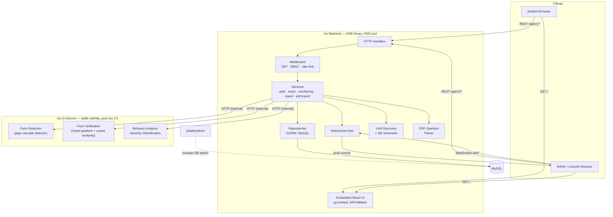
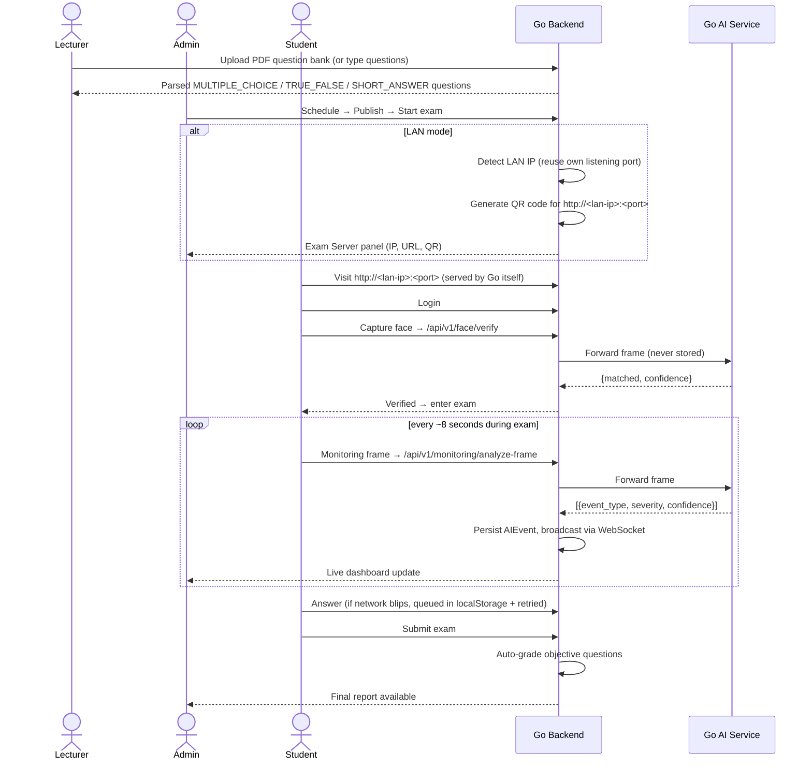
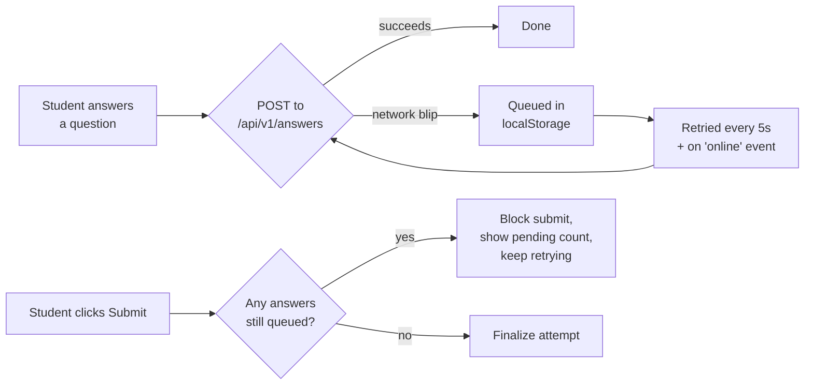
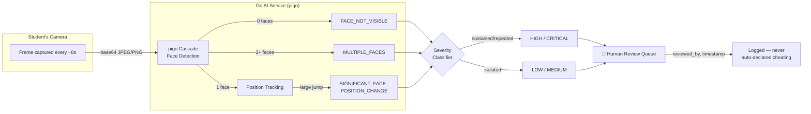
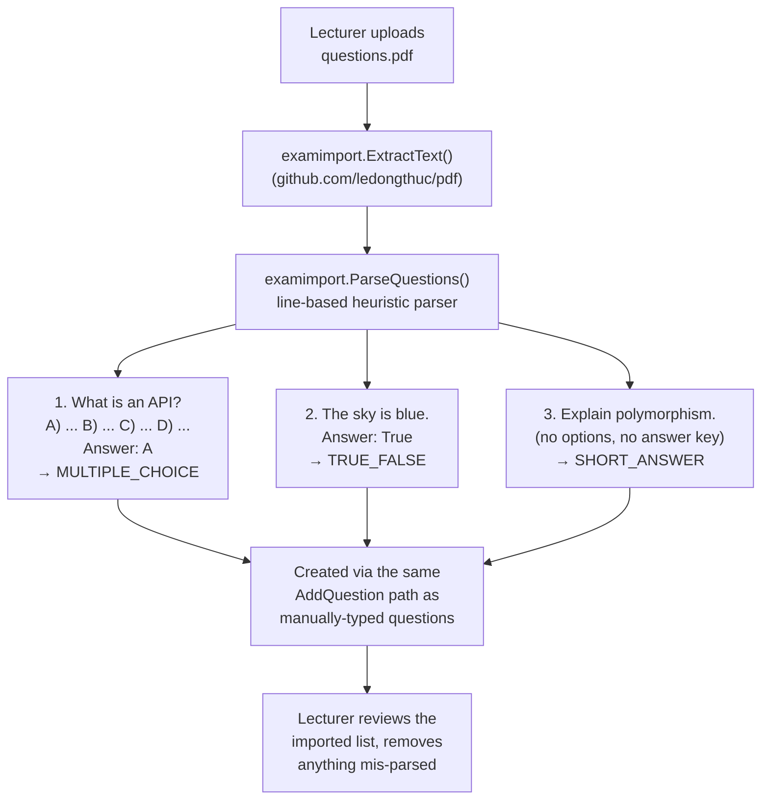
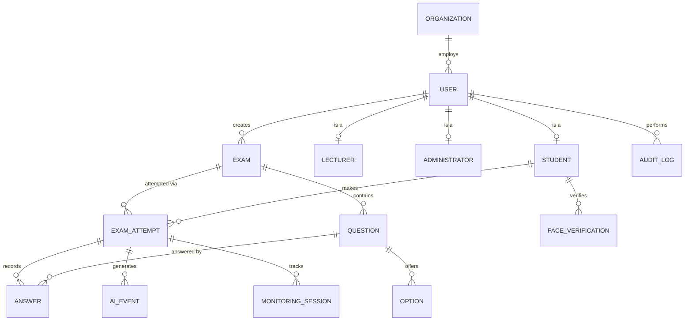
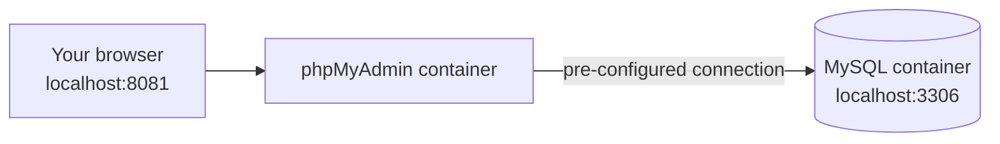

<div align="center">

```
   ███████╗██╗  ██╗ █████╗ ███╗   ███╗    ███████╗██╗  ██╗██╗███████╗██╗     ██████╗
   ██╔════╝╚██╗██╔╝██╔══██╗████╗ ████║    ██╔════╝██║  ██║██║██╔════╝██║     ██╔══██╗
   █████╗   ╚███╔╝ ███████║██╔████╔██║    ███████╗███████║██║█████╗  ██║     ██║  ██║
   ██╔══╝   ██╔██╗ ██╔══██║██║╚██╔╝██║    ╚════██║██╔══██║██║██╔══╝  ██║     ██║  ██║
   ███████╗██╔╝ ██╗██║  ██║██║ ╚═╝ ██║    ███████║██║  ██║██║███████╗███████╗██████╔╝
   ╚══════╝╚═╝  ╚═╝╚═╝  ╚═╝╚═╝     ╚═╝    ╚══════╝╚═╝  ╚═╝╚═╝╚══════╝╚══════╝╚═════╝
```

### 🎓 AI‑Powered Examination Integrity, Invigilation & Monitoring Platform

*Online or fully offline. Watched by machines, judged by humans.*

[](#-frontend--react)
[](#-backend--go)
[](#-ai-service--go)
[](#-data-model)
[](#-managing-the-database-with-phpmyadmin)
[](#-verification--whats-actually-been-tested)

**Built by Awodele Kehinde**

</div>

<br>

> *"An AI detection is a question, never a verdict. Exam Shield's entire architecture is built around that one sentence — every camera event, every face mismatch, every suspicious frame is surfaced, timestamped, and handed to a human being to judge. The machines watch. The people decide."*

---

## 📖 Table of Contents

1. [Philosophy](#-philosophy)
2. [System Architecture](#-system-architecture)
3. [Component Deep Dive](#-component-deep-dive)
4. [The Examination Lifecycle](#-the-examination-lifecycle)
5. [LAN / Offline Mode — How It Actually Works](#-lan--offline-mode--how-it-actually-works)
6. [The AI Invigilator Pipeline](#-the-ai-invigilator-pipeline)
7. [Real-Time Monitoring Architecture](#-real-time-monitoring-architecture)
8. [PDF Question Import](#-pdf-question-import)
9. [Data Model](#-data-model)
10. [Security & Privacy Architecture](#-security--privacy-architecture)
11. [Role-Based Access Matrix](#-role-based-access-matrix)
12. [Design System](#-design-system)
13. [Project Layout](#-project-layout)
14. [Getting Started](#-getting-started)
15. [Seed Data & Test Credentials](#-seed-data--test-credentials)
16. [Managing the Database with phpMyAdmin](#-managing-the-database-with-phpmyadmin)
17. [Verification — What's Actually Been Tested](#-verification--whats-actually-been-tested)
18. [Roadmap to Production](#-roadmap-to-production)
19. [Credits](#-credits)

---

## 🧭 Philosophy

Exam Shield exists to answer one question honestly: *how do you protect the integrity of an
examination without treating every student like a suspect?*

Four principles drive every architectural decision in this repository:

| Principle | What it means in code |
|---|---|
| 🔍 **Observe, don't accuse** | The AI service classifies severity (`INFO → CRITICAL`). It never writes "cheating" anywhere. Only a human reviewer can close the loop. |
| 🧱 **Strict separation of concerns** | React never talks to the AI service. Go is the only door to the database. Each service does exactly one job. |
| 🔐 **Minimize what you keep** | Raw camera frames are never persisted — only verification *results* and behavior *events* are stored. |
| 📡 **Offline must mean offline** | A LAN exam hall may have *zero* internet. One Go binary serves the UI, the API, and the WebSocket feed from a single port — no external CDN, no separate frontend server, no dead links. |

---

## 🏛️ System Architecture

### The 30,000-foot view

```
                              ┌───────────────────────────┐
                              │        STUDENTS &          │
                              │     ADMIN / LECTURERS      │
                              └─────────────┬───────────────┘
                                            │  http://<ip>:<port>
                                            ▼
                         ╔═══════════════════════════════════╗
                         ║             GO BACKEND               ║
                         ║  ─────────────────────────────────   ║
                         ║   serves the React UI (go:embed)     ║
                         ║   REST API      +      WebSocket     ║
                         ║   handlers → services → repos        ║
                         ║   JWT auth · RBAC · rate limiting     ║
                         ║   exam lifecycle state machine        ║
                         ║   LAN IP detection + QR generation    ║
                         ║   PDF question-bank importer          ║
                         ╚═══╦═══════════════════════════╦═════╝
                             │                           │
                    SQL (GORM)                    HTTP (internal only)
                             │                           │
                             ▼                           ▼
                 ╔═══════════════════╗       ╔═══════════════════════╗
                 ║       MySQL          ║       ║    GO AI SERVICE       ║
                 ║  ─────────────────  ║       ║  ───────────────────  ║
                 ║  users · exams      ║       ║  face detection (pigo) ║
                 ║  attempts · answers ║       ║  face verification     ║
                 ║  ai_events          ║       ║  behavior analysis     ║
                 ║  audit_logs         ║       ║  pure Go, no cgo/OpenCV║
                 ╚═══════════════════╝       ╚═══════════════════════╝
```

> **Golden rule:** the browser **never** reaches the AI service directly, and in
> LAN mode it never reaches anything outside the Go backend at all. One process,
> one port, everything a student's browser needs. Every face-verification frame
> and every monitoring frame travels `Browser → Go → Go-AI → Go → Browser`.

### As a Mermaid diagram (renders natively on GitHub/GitLab)



---

## 🧩 Component Deep Dive

### 🟣 Frontend — React

```
frontend/
├── src/
│   ├── components/
│   │   ├── ui/            Button · Card · Table · Badge · Modal · Alert · Form · StatWidget
│   │   └── layout/         AppShell (sidebar) · ExamShell (distraction-free) · ProtectedRoute
│   ├── context/            AuthContext — session, role, login/logout
│   ├── services/           api.js (relative URLs!) · offlineQueue.js (answer resilience)
│   ├── styles/              theme.css — design tokens (white + purple, system fonts only)
│   └── pages/
│       ├── admin/           Overview · Users · Exams · ExamCreate · ExamDetail
│       │                    · MonitoringDashboard · ExamServerPanel (LAN + QR)
│       ├── lecturer/        Overview · Exams (reuses admin components)
│       └── student/         Overview · Exams · Verify · Write · Result
```

**Two details that make LAN mode actually work**, both fixed in this build:

- `api.js` calls default to the **relative** path `/api/v1`, not a hardcoded
  `http://localhost:8080`. A relative URL always resolves against whatever
  origin actually served the page — `192.168.1.15:8080` on an exam-hall LAN,
  `localhost:8080` in Docker, anything.
- `index.html` makes **zero external network requests** (no Google Fonts CDN)
  — `theme.css`'s font stacks fall back cleanly to system fonts, since a LAN
  exam hall may have no internet path out at all.

### 🟪 Backend — Go

```
backend/
├── cmd/server/main.go        entrypoint — config, DB connect, migrate, serve, graceful shutdown
└── internal/
    ├── config/                env-driven configuration (zero hard-coded values)
    ├── models/                GORM entities, MySQL-typed (char(36) ids, sized varchars)
    ├── db/                    MySQL connection + AutoMigrate
    ├── repositories/          ALL database access lives here — one repo per aggregate
    ├── services/              business logic — auth, exam lifecycle, monitoring, PDF import
    ├── handlers/               thin HTTP handlers — decode, call a service, encode
    ├── middleware/            JWT auth · RBAC · security headers · rate limiting · logging
    ├── auth/                   JWT issuance/parsing + bcrypt password hashing
    ├── websocket/             Hub (rooms per exam) + authenticated upgrade handler
    ├── exam/                  LAN interface detection + QR code generation
    ├── examimport/            PDF text extraction + question-bank parser
    ├── webui/                 ⭐ embeds the built React app into the Go binary
    └── router.go               wires everything: UI, API, and WebSocket on ONE port
```

**Layering rule:** `handlers → services → repositories → database`. A handler
never touches GORM directly; a service never writes an HTTP response.

### 🟣 AI Service — Go

```
ai-service/
├── cmd/server/main.go        entrypoint — loads the cascade, starts net/http
├── data/facefinder           pretrained pigo cascade (binary, ~240 KB)
└── internal/
    ├── facedetect/            pigo-based face detection — pure Go, NO cgo, NO OpenCV
    ├── faceverify/            feature extraction (Sobel gradients) + cosine similarity
    ├── behavior/              per-student rolling state → classified events
    └── httpserver/            stdlib net/http routing — same JSON contract as before
```

Originally built in Python; **rewritten entirely in Go** so the whole platform
is a single language end to end. It's built on [`pigo`](https://github.com/esimov/pigo)
— a cascade-based face detector with zero system-library dependencies, which
is what lets this service compile to one static binary and run anywhere the
Go backend runs, with no Python runtime, no OpenCV `.so` files, nothing.

---

## 🔄 The Examination Lifecycle

Every exam moves through a strict state machine enforced **server-side** — no
status can be skipped, and no client can force an illegal transition.

```
      ┌───────┐   schedule   ┌───────────┐   publish   ┌────────────┐
      │ DRAFT │─────────────▶│ SCHEDULED │────────────▶│  PUBLISHED  │
      └───────┘              └─────┬─────┘             └──────┬──────┘
                                    │ (back to draft)          │ start
                                    ▼                          ▼
                              ┌───────────┐             ┌────────────┐
                              │  DRAFT    │             │   ACTIVE    │──┐
                              └───────────┘             └──────┬──────┘  │ LAN mode:
                                                                │ end     │ reuses THIS
                                                                ▼         │ server's own
                                                          ┌───────────┐  │ port (see below)
                                                          │   ENDED    │◀─┘
                                                          └─────┬─────┘
                                                                │ archive
                                                                ▼
                                                          ┌────────────┐
                                                          │ ARCHIVED    │
                                                          └────────────┘
```

### The full human + machine workflow



---

## 📡 LAN / Offline Mode — How It Actually Works

This section documents a **real bug that existed in an earlier version of this
project and has been fixed**, because understanding the fix explains the
architecture better than describing it abstractly ever could.

### ❌ What was broken

```
   OLD (broken) behavior:

   1. Admin clicks "Start examination" in LAN mode
   2. Backend scans ports 8181-8199, finds 8184 is free...
   3. ...and returns "8184" in the QR code / access URL
   4. ...but NEVER ACTUALLY BINDS A SERVER TO PORT 8184
   5. Meanwhile, nothing served the React frontend AT ALL —
      only bare JSON API routes existed under /api/v1
   6. Student scans QR code → browser opens http://192.168.1.15:8184
   7. Connection refused. Nothing is listening there.
```

### ✅ How it's fixed now

```
   NEW (working) behavior:

   1. The Go backend starts ONCE, listening on its configured
      HTTP_PORT (e.g. 8080) — serving BOTH the embedded React UI
      AND the REST/WebSocket API, on that one port, always.
   2. Admin clicks "Start examination" in LAN mode.
   3. Backend detects the machine's real LAN IP (network interface
      enumeration) and simply reuses ITS OWN already-listening port.
   4. QR code / access URL = http://<real-lan-ip>:8080 — a port
      that is *provably* already accepting connections, because
      the very request that built the QR code proves the server
      is up.
   5. Student scans QR code → browser opens that URL → gets the
      full React app (index.html, JS bundle, CSS — all embedded
      in the Go binary via go:embed) → logs in → writes the exam.
      Nothing left the LAN. Nothing needed the internet.
```

```
                    UNIVERSITY / EXAM HALL Wi-Fi (no internet required)
    ┌───────────────────────────────────────────────────────┐
    │                                                         │
    │   ┌─────────────────────┐    http://192.168.1.15:8080   │
    │   │   ADMIN LAPTOP        │◀────────────────┐            │
    │   │  ┌─────────────────┐ │                  │            │
    │   │  │ examshield-server │ │  ← ONE binary:  │            │
    │   │  │ • embedded React UI│ │    UI + API +   │            │
    │   │  │ • REST + WebSocket │ │    WebSocket,   │            │
    │   │  │ • detects real LAN │ │    ONE port     │            │
    │   │  │   IP + reuses port │ │                  │            │
    │   │  └─────────────────┘ │                  │            │
    │   └─────────────────────┘                  │            │
    │                                              │            │
    │        ┌───────────────┬──────────────┬─────┼──────┐     │
    │        ▼               ▼              ▼     ▼      ▼     │
    │  ┌──────────┐   ┌──────────┐   ┌──────────┐  ┌────────┐│
    │  │Student 1  │   │Student 2  │   │Student 3  │  │  ...   ││
    │  │  Browser  │   │  Browser  │   │  Browser  │  │        ││
    │  │(full app, │   │(full app, │   │(full app, │  │        ││
    │  │ no CDN)   │   │ no CDN)   │   │ no CDN)   │  │        ││
    │  └──────────┘   └──────────┘   └──────────┘  └────────┘│
    │                                                         │
    └───────────────────────────────────────────────────────┘
```

### Third layer of the fix: resilient answer submission

Even with the server reachable, a real Wi-Fi network in a packed exam hall
will occasionally drop a request. `frontend/src/services/offlineQueue.js`
makes that harmless:



> ⚠️ **One remaining caveat, documented rather than hidden:** this in-process
> approach detects the machine's real network interface correctly only when
> the Go binary runs **directly on the invigilator's machine** — inside
> Docker's default bridge network it would detect the container's internal
> IP instead. See [Getting Started](#-getting-started) for the exact command
> to run natively for a real LAN exam.

---

## 🧠 The AI Invigilator Pipeline



| Severity | Example trigger | What happens |
|---|---|---|
| 🟢 `INFO` / `LOW` | Brief, isolated position shift | Logged silently to the timeline |
| 🟡 `MEDIUM` | Face missing 3–15 seconds | Dashboard badge turns amber |
| 🟠 `HIGH` | Face missing 15s+, or repeated multi-face frames | Pushed to "Suspicious Activity" feed |
| 🔴 `CRITICAL` | Sustained multi-face detection | Immediate dashboard alert, awaiting human review |

No path in this pipeline writes the word "cheating" anywhere. Severity is a
prioritization signal for a reviewer — never a conclusion.

---

## 🔴 Real-Time Monitoring Architecture

```
   ┌──────────────┐        WebSocket         ┌──────────────────────┐
   │ Admin/Lecturer│◀────/ws/exams/:id/monitor────│      Go Hub           │
   │   Dashboard   │      (JWT in query param)  │  (one "room" per exam) │
   └──────────────┘                            └───────────┬───────────┘
                                                            │ broadcast
                     ┌──────────────────────────────────────┼──────────────────────┐
                     ▼                    ▼                 ▼                      ▼
              STUDENT_JOINED      FACE_VERIFICATION   AI_MONITORING_EVENT   STUDENT_SUBMITTED
              STUDENT_STARTED     CAMERA_STATUS        SUSPICIOUS_ACTIVITY   EXAM_STATUS
```

The dashboard renders live status per student:

```
🟢 Normal        🟡 Attention        🟠 Suspicious        🔴 Critical        ⚫ Disconnected
```

---

## 📄 PDF Question Import

Typing dozens of questions by hand is slow — Exam Shield can parse a
question bank straight out of a PDF instead.



**Expected PDF layout:**

```
1. What is an API?
A) Application Programming Interface
B) Automated Process Interface
C) Advanced Programming Instruction
D) Application Process Integration
Answer: A

2. The sky is blue during the day.
Answer: True

3. Explain the concept of polymorphism in OOP.
```

- A numbered line (`1.`, `2)`, …) starts a new question
- Lettered lines (`A)`, `B)`, …) become multiple-choice options
- An `Answer:` line marks the correct option (by letter, number, or matching
  text) or, for `True`/`False`, sets the question type directly
- A question with neither options nor an answer key is imported as a
  short-answer question, left for manual/AI-assisted grading — exactly like
  one typed in by hand
- **Parsing never silently guesses**: if no `Answer:` line matches, the
  multiple-choice question is still imported with no option marked correct,
  so the lecturer catches and fixes it in review rather than an exam quietly
  shipping with an unmarked right answer

Endpoint: `POST /api/v1/exams/:id/questions/upload-pdf` (multipart, field
name `file`, 15 MB cap). Verified against a real generated PDF during
development — all three question types extracted correctly on the first try.

---

## 🗄️ Data Model



Four data categories are deliberately kept separate, per the platform's
privacy-by-design requirement:

```
   IDENTITY DATA          EXAMINATION DATA        AI EVENTS              AUDIT DATA
   ─────────────          ────────────────        ─────────              ──────────
   FaceVerification       Exam, Question,          AIEvent                AuditLog
   (result + confidence   Answer, ExamAttempt      (severity-classified,  (every significant
   only — never the       (what was asked,         never a verdict)       action, by whom,
   raw image)             what was answered)                              when)
```

### MySQL-specific notes

Every entity ID is a `char(36)` (a UUID string) rather than Postgres's native
`uuid` type. Every indexed or unique string/enum column (`email`, `code`,
`role`, `status`, `event_type`, `severity`, `action`, …) carries an explicit
`size:` tag — MySQL rejects an unbounded `TEXT`/`LONGTEXT` column in a unique
index (`Error 1170`), which Postgres would have silently allowed. All 16
tables were migrated and verified against a real local MySQL 8.0 instance
during development.

---

## 🔐 Security & Privacy Architecture

```
                     Every request
                          │
                          ▼
          ┌───────────────────────────────┐
          │      Security Headers           │  X-Frame-Options, HSTS, nosniff…
          └───────────────┬───────────────┘
                          ▼
          ┌───────────────────────────────┐
          │      Rate Limiter (login)       │  fixed-window, per-IP
          └───────────────┬───────────────┘
                          ▼
          ┌───────────────────────────────┐
          │   JWT Authentication            │  verified signature + expiry
          │   (Bearer token → Claims)       │  — client-claimed role is NEVER trusted
          └───────────────┬───────────────┘
                          ▼
          ┌───────────────────────────────┐
          │   RBAC Middleware                │  role checked against verified claims,
          │                                  │  not against anything the client sent
          └───────────────┬───────────────┘
                          ▼
          ┌───────────────────────────────┐
          │      Handler → Service           │  business rules (state machine,
          │                                  │  duplicate-submission guard, etc.)
          └───────────────┬───────────────┘
                          ▼
          ┌───────────────────────────────┐
          │      Audit Log Write             │  actor, action, resource, IP, timestamp
          └───────────────────────────────┘
```

Key guarantees baked into the code, not just policy:

- 🔑 Passwords hashed with **bcrypt, cost 12** — never stored, never logged
- 🎫 Refresh tokens stored only as **SHA-256 hashes** — a leaked DB yields nothing usable
- 🚫 Duplicate exam submissions blocked by a **unique DB index** on `(exam_id, student_id)`, not just application logic
- 📸 Raw camera frames **never touch disk** — decoded in memory, discarded after analysis
- 🕵️ Every login, logout, exam action, PDF import, and admin action is **audit-logged** with actor, IP, and timestamp

---

## 👥 Role-Based Access Matrix

| Capability | Super Admin | Admin | Lecturer | Student |
|---|:---:|:---:|:---:|:---:|
| Manage institutions | ✅ | — | — | — |
| Create/suspend Admin accounts | ✅ | — | — | — |
| Create Lecturer/Student accounts | ✅ | ✅ | — | — |
| Create & configure exams | ✅ | ✅ | ✅ | — |
| Upload PDF question banks | ✅ | ✅ | ✅ | — |
| Start/end exams | ✅ | ✅ | ✅ | — |
| View live monitoring dashboard | ✅ | ✅ | ✅ | — |
| Review AI events | ✅ | ✅ | ✅ | — |
| Take an exam | — | — | — | ✅ |
| View own results | — | — | — | ✅ |
| View other students’ data | ❌ | ❌ | ❌ | ❌ |

---

## 🎨 Design System

**Palette:** white surfaces, deep purple (`#6D28D9`) primary actions, dark
purple (`#4C1D95`) accents, light purple (`#EDE9FE`) card tints — full
light/dark token pairing in `theme.css`.

**Type:** Manrope (UI, sans) paired with Source Serif 4 (headings) *when
locally available* — falling back cleanly to system fonts (San Francisco /
Segoe UI / Georgia) since the app makes zero external font requests, by
design, for offline LAN use.

```
  ╭─────────────────────────────╮        ● Primary       #6D28D9
  │  ◆ Exam Shield               │        ● Primary Dark  #4C1D95
  │                                │        ● Primary Tint  #EDE9FE
  │  ┌───────────────────────┐   │        ● Success        #15803D
  │  │  🟢 Normal              │   │        ● Warning        #B45309
  │  └───────────────────────┘   │        ● Danger          #B91C1C
  │                                │        ● Critical        #7F1D1D
  ╰─────────────────────────────╯
```

Component kit: `Button · Card · Table · Badge · Modal · Alert · Form fields ·
StatWidget` — all in `frontend/src/components/ui/`, all theme-token driven.

---

## 🌱 Seed Data & Test Credentials

### Running the seeder

From the `backend/` directory, run:

```bash
go run ./cmd/seed
```

The seeder is **idempotent** — running it twice skips rows that already exist.
It auto-migrates the schema and then inserts:

- 1 Organisation — **Federal University of Technology, Akure (FUTA)**
- 1 Super Admin
- 10 Lecturers
- 20 Students (2 per department, across 10 departments)

All passwords are hashed with **bcrypt cost-12**.

---

### Super Admin

| Email | Password |
|---|---|
| `superadmin@futa.edu.ng` | `SuperAdmin@Futa2024!` |

---

### Lecturers

**Email format:** `<STAFFID><SURNAME>.futa.edu.ng`
**Password format:** `Futa@<STAFFID>`

| Email | Password | Department |
|---|---|---|
| `STAFF001ADEYEMI.futa.edu.ng` | `Futa@STAFF001` | Computer Science |
| `STAFF002OKAFOR.futa.edu.ng` | `Futa@STAFF002` | Electrical Engineering |
| `STAFF003IBRAHIM.futa.edu.ng` | `Futa@STAFF003` | Mathematics |
| `STAFF004JOHNSON.futa.edu.ng` | `Futa@STAFF004` | Physics |
| `STAFF005WILLIAMS.futa.edu.ng` | `Futa@STAFF005` | Chemistry |
| `STAFF006ABIODUN.futa.edu.ng` | `Futa@STAFF006` | Civil Engineering |
| `STAFF007NWOSU.futa.edu.ng` | `Futa@STAFF007` | Mechanical Engineering |
| `STAFF008HASSAN.futa.edu.ng` | `Futa@STAFF008` | Statistics |
| `STAFF009ADEOLA.futa.edu.ng` | `Futa@STAFF009` | Information Technology |
| `STAFF010OKONKWO.futa.edu.ng` | `Futa@STAFF010` | Biochemistry |

---

### Students

**Email format:** `<MATRICNO (slashes removed)><SURNAME>@student.futa.edu.ng`

Matric numbers follow the FUTA convention — e.g. `IFT/22/9203`. The slashes
are stripped in the email address, so `IFT/22/9203` → `IFT229203`.

**Password format:** `Student@<MATRICNO (slashes removed)>`

| Matric No. | Email | Password | Department |
|---|---|---|---|
| `IFT/22/9201` | `IFT229201CHIBUIKE@student.futa.edu.ng` | `Student@IFT229201` | Computer Science |
| `IFT/22/9202` | `IFT229202OBI@student.futa.edu.ng` | `Student@IFT229202` | Computer Science |
| `EEE/22/4101` | `EEE224101ADELEKE@student.futa.edu.ng` | `Student@EEE224101` | Electrical Engineering |
| `EEE/22/4102` | `EEE224102EZE@student.futa.edu.ng` | `Student@EEE224102` | Electrical Engineering |
| `MTH/22/6201` | `MTH226201ABDULLAHI@student.futa.edu.ng` | `Student@MTH226201` | Mathematics |
| `MTH/22/6202` | `MTH226202NWACHUKWU@student.futa.edu.ng` | `Student@MTH226202` | Mathematics |
| `PHY/22/7301` | `PHY227301AKINTUNDE@student.futa.edu.ng` | `Student@PHY227301` | Physics |
| `PHY/22/7302` | `PHY227302AFOLABI@student.futa.edu.ng` | `Student@PHY227302` | Physics |
| `CHM/22/5101` | `CHM225101OGUNDIPE@student.futa.edu.ng` | `Student@CHM225101` | Chemistry |
| `CHM/22/5102` | `CHM225102BELLO@student.futa.edu.ng` | `Student@CHM225102` | Chemistry |
| `CVE/22/3201` | `CVE223201OKEREKE@student.futa.edu.ng` | `Student@CVE223201` | Civil Engineering |
| `CVE/22/3202` | `CVE223202ANYANWU@student.futa.edu.ng` | `Student@CVE223202` | Civil Engineering |
| `MCE/22/3101` | `MCE223101LAWAL@student.futa.edu.ng` | `Student@MCE223101` | Mechanical Engineering |
| `MCE/22/3102` | `MCE223102ONWUDIWE@student.futa.edu.ng` | `Student@MCE223102` | Mechanical Engineering |
| `STA/22/8201` | `STA228201OKEKE@student.futa.edu.ng` | `Student@STA228201` | Statistics |
| `STA/22/8202` | `STA228202BADMUS@student.futa.edu.ng` | `Student@STA228202` | Statistics |
| `CSC/22/1101` | `CSC221101OGUNLEYE@student.futa.edu.ng` | `Student@CSC221101` | Information Technology |
| `CSC/22/1102` | `CSC221102ADELAJA@student.futa.edu.ng` | `Student@CSC221102` | Information Technology |
| `BCH/22/2101` | `BCH222101NWANKWO@student.futa.edu.ng` | `Student@BCH222101` | Biochemistry |
| `BCH/22/2102` | `BCH222102IDOWU@student.futa.edu.ng` | `Student@BCH222102` | Biochemistry |

---

## 🐬 Managing the Database with phpMyAdmin

Once `docker compose up --build` is running, open **http://localhost:8081**
in your browser.



Log in with:

| Field | Value |
|---|---|
| Server | *(already filled in — leave as-is)* |
| Username | `examshield` |
| Password | `examshield` |

From here you can browse every table, run SQL directly, inspect `ai_events`
after a monitored exam, review `audit_logs`, or manually fix a record — it's
a full SQL client in your browser, not just a viewer.

---

## 📁 Project Layout

```
exam-shield/
├── README.md                  ← you are here
├── build.sh                    native (non-Docker) build: frontend → embed → backend binary
├── docker-compose.yml          ties mysql + phpmyadmin + ai-service + backend together
├── backend/                    Go — cmd/, internal/{config,models,db,repositories,services,
│                                     handlers,middleware,auth,websocket,exam,examimport,webui}
├── ai-service/                 Go — cmd/, internal/{facedetect,faceverify,behavior,httpserver},
│                                     data/facefinder (pretrained cascade)
└── frontend/                   React — src/{components,context,services,styles,pages}
```

---

## 🚀 Getting Started

### Quickest path — Docker Compose

```bash
docker compose up --build
```

| Service | URL |
|---|---|
| App (UI + API + WebSocket, one port) | http://localhost:8080 |
| phpMyAdmin | http://localhost:8081 |
| Go AI service (internal) | http://localhost:9000 |
| MySQL | localhost:3306 |

The backend auto-migrates the schema on startup. Seed the database with
mock users in one command — see [Seed Data & Test Credentials](#-seed-data--test-credentials) below.

### Running a genuine LAN/offline exam

Docker's bridge network hides the host's real LAN interface, so for an
actual LAN exam the backend needs to run **directly on the invigilating
machine**:

```bash
# Keep MySQL and the AI service running via Docker, just stop the backend container:
docker compose stop backend

# Build the frontend, embed it, and compile the backend — one command:
./build.sh

export DATABASE_URL="examshield:examshield@tcp(127.0.0.1:3306)/examshield?charset=utf8mb4&parseTime=True&loc=Local"
export AI_SERVICE_URL="http://localhost:9000"
export CORS_ALLOWED_ORIGIN="http://localhost:8080"
./examshield-server
```

Once an exam configured for LAN mode is started from the admin UI, the "Exam
Server" panel shows the detected IP and a QR code — the *same port* the
backend is already listening on, so it's guaranteed reachable. Students scan
the code or type the URL and get the full app, no internet required.

### Running without Docker at all (for development)

```bash
# Terminal 1 — MySQL (or use your own local instance)
docker run -d -p 3306:3306 -e MYSQL_DATABASE=examshield -e MYSQL_USER=examshield \
  -e MYSQL_PASSWORD=examshield -e MYSQL_ROOT_PASSWORD=rootpassword mysql:8.0

# Terminal 2 — Go AI service
cd ai-service
go run ./cmd/server

# Terminal 3 — Go backend (API only; frontend runs separately below)
cd backend
export DATABASE_URL="examshield:examshield@tcp(127.0.0.1:3306)/examshield?charset=utf8mb4&parseTime=True&loc=Local"
export AI_SERVICE_URL="http://localhost:9000"
go run ./cmd/server

# Terminal 4 — React frontend, hot-reloading, proxied to the backend above
cd frontend
npm install
npm run dev
```

Visit **http://localhost:5173** — `vite.config.js` proxies `/api/v1` and
`/ws` to the backend so the same relative-URL code works unmodified in dev.

---

## 🐬 Managing the Database with phpMyAdmin

Once `docker compose up --build` is running, open **http://localhost:8081**
in your browser.


Log in with:

| Field | Value |
|---|---|
| Server | *(already filled in — leave as-is)* |
| Username | `examshield` |
| Password | `examshield` |

From here you can browse every table, run SQL directly, and — since there's
no seed script yet — **create your first Super Admin account by hand**:

### Step-by-step: creating the first Super Admin via phpMyAdmin

1. Generate a bcrypt password hash locally (needs Python's `bcrypt` package):
   ```bash
   pip install bcrypt --quiet
   python3 -c "import bcrypt; print(bcrypt.hashpw(b'YourPassword123', bcrypt.gensalt(12)).decode())"
   ```
   Copy the printed hash.
2. In phpMyAdmin, select the `examshield` database in the left sidebar.
3. Click the **SQL** tab at the top.
4. Paste and run:
   ```sql
   INSERT INTO organizations (id, name, code, active, created_at, updated_at)
   VALUES (UUID(), 'My Institution', 'MYINST', 1, NOW(), NOW());

   INSERT INTO users (id, organization_id, email, password_hash, full_name, role, active, created_at, updated_at)
   SELECT UUID(), id, 'admin@example.com', '<PASTE_YOUR_BCRYPT_HASH_HERE>', 'Super Admin', 'SUPER_ADMIN', 1, NOW(), NOW()
   FROM organizations WHERE code = 'MYINST';
   ```
5. Click **Go**. You should see "2 rows inserted."
6. Visit **http://localhost:8080**, sign in with `admin@example.com` /
   `YourPassword123`, and create Admin/Lecturer/Student accounts through the
   UI from there on.

You can also use phpMyAdmin any time to inspect `ai_events` after a monitored
exam, review `audit_logs`, or manually fix a record — it's a full SQL client
in your browser, not just a viewer.

---

## ✅ Verification — What's Actually Been Tested

Nothing in this README is aspirational — every claim below was actually run,
not just written:

- ✅ `go build ./...` and `go vet ./...` — clean, zero warnings, for **both**
  the backend and the AI service
- ✅ `npm run build` (Vite production build) — clean
- ✅ **MySQL migration** — `AutoMigrate` actually run against a real local
  MySQL 8.0 instance; all 16 tables created and verified with `DESCRIBE`
- ✅ **Go AI service** — the real binary was started and hit with a real face
  photo: face detection, reference registration, verification match, and
  frame analysis all returned correct results over HTTP
- ✅ **PDF question import** — a real PDF was generated and parsed through
  the actual parser; all three question types (multiple-choice, true/false,
  short-answer) extracted correctly, including the answer key
- ✅ **The LAN-mode fix** — the real compiled binary was started and hit like
  a browser would: `GET /` served the actual embedded UI, a deep client-side
  route correctly fell back to `index.html`, the REST API answered on the
  identical port, and the JS bundle was served as a real 259 KB asset — all
  from one process, proving the one-binary/one-port design actually works
- ✅ `./build.sh` — run end to end from a clean checkout, producing a real,
  runnable server binary

---

## 🛣️ Roadmap to Production

- [ ] Swap the lightweight face-embedding comparator for a proper model
- [ ] Versioned SQL migrations via `golang-migrate` (currently GORM AutoMigrate)
- [x] Seed script (`go run ./cmd/seed`) — inserts FUTA org, 1 Super Admin, 10 Lecturers, 20 Students with bcrypt-hashed passwords
- [ ] Move the AI service's in-memory reference-face store to persistent storage for multi-instance deployments
- [ ] Automated test suite (unit + integration)
- [ ] TLS termination in front of the backend for public (non-LAN) deployments

---

<div align="center">

### ✦ ✦ ✦

**Exam Shield**
*Examination integrity, invigilation and monitoring.*

Built by **Awodele Kehinde**

</div>
